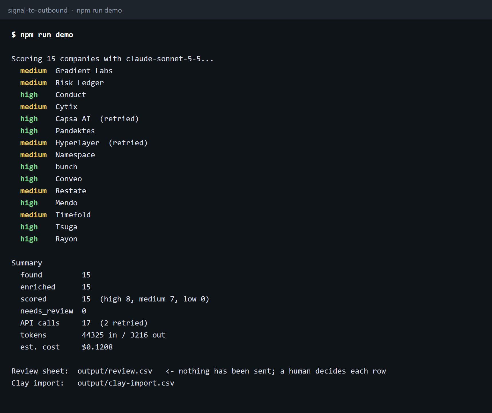
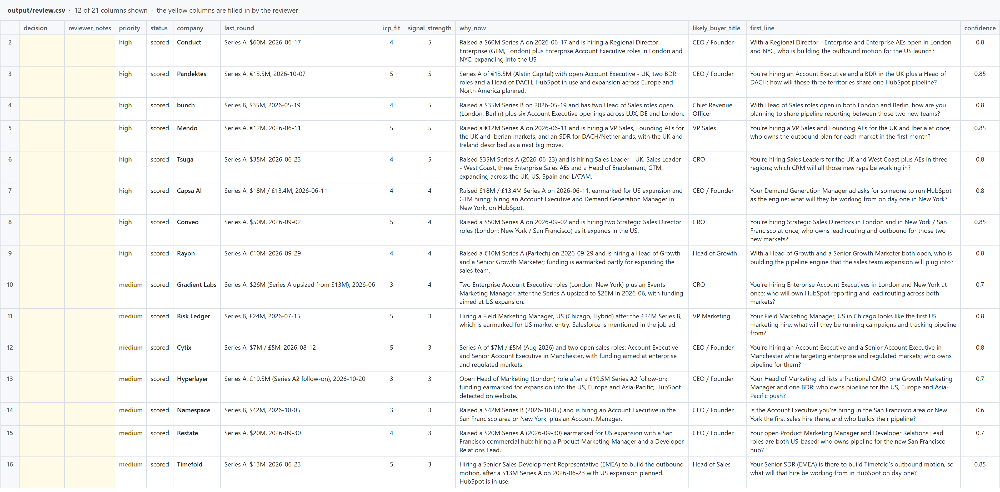
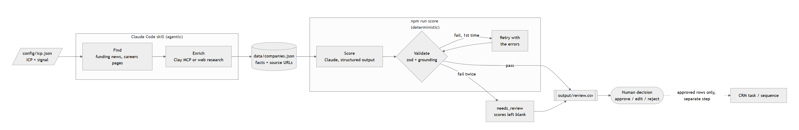
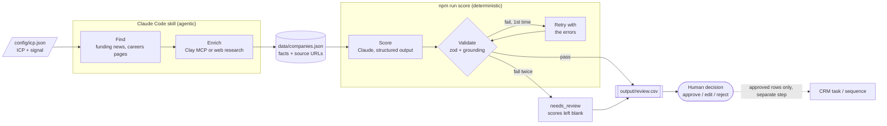

# signal-to-outbound

A Claude Code skill that turns an ICP and a buying signal into a sourced, scored review sheet. It finds companies that match the profile and are showing the signal now, enriches them from public sources, scores each with Claude against a strict schema, drafts an opening line, and writes a CSV where a human approves or rejects every row. It never sends an email and never writes to a CRM.

The demo run targets Mazorda's own ideal customer: UK/EU B2B SaaS companies, Series A to C, funded in the last six months, 20-300 people, and hiring GTM, RevOps, SDR or growth roles.

This is an independent demo built as part of a job application. It is not affiliated with or endorsed by Mazorda.

| A run | The review sheet |
|---|---|
|  |  |

Both images are rendered from the real output of the run described below: the terminal log and `output/review.csv`.

## Flow



The same diagram as Mermaid source:



The find and enrich steps are judgement work, so the skill does them in Claude Code. Scoring is repeatable, so it is a small TypeScript script that can also run on a schedule.

## Setup

Requires Node 20.12 or later.

```bash
npm install
cp .env.example .env      # then set ANTHROPIC_API_KEY
```

Optional, for Clay enrichment: in Claude Code run `/plugin marketplace add clay-run/agent-plugins`, then `/plugin install clay@clay-plugins`, then sign in with `clay login`. The skill detects Clay, lists what it can do with the cost per company, and asks before spending credits. The Clay CLI runs on macOS and Linux; on Windows it runs inside WSL.

## Run

| Command | What it does |
|---|---|
| `npm run demo` | Scores the companies in `data/companies.json` and writes `output/review.csv`, `output/clay-import.csv` and `output/summary.json`. About 15 API calls. |
| `npm run score -- --limit 3` | Same, first 3 companies only. |
| `npm run score -- --input other.json` | Score a different company file. |
| `npm test` | Runs 8 offline tests of validation, retry and `needs_review` (no API calls). |
| `/signal-to-outbound` in Claude Code | Runs the full skill: find, enrich, score, report. |

A run that could exceed 50 API calls stops and asks for `--yes`.

## Change the ICP

Edit `config/icp.json`: the seller, the ICP criteria, the primary and bonus signals, and the buyer titles. The scoring prompt is built from that file, so no code changes are needed. Then run the skill to find and enrich companies for the new profile.

## Design decisions

**Structured output plus zod, as two layers.** The API call uses a JSON schema (`output_config.format`), which guarantees the response has the right fields and types. JSON-schema structured output cannot express "integer from 1 to 5" or "at most 160 characters", so `Score` in `src/schema.ts` adds those rules and every response is checked with zod. One schema definition feeds both layers.

**Retry once, then stop.** A failed response is sent back with the exact validation errors. If the second attempt also fails, the row is written as `needs_review` with the scores blank and the reason in `validation_notes`. A blank row costs a reviewer a minute. A guessed row can cost a prospect's trust.

**Grounding check.** The model is only allowed to use facts from the company record. `src/validate.ts` enforces a simple version of that: every number and every proper noun (a capitalised word that is not the first word of a sentence) in `why_now` and `first_line` must appear in the record. An invented amount, investor or city fails the row. A short banned-word list also rejects flattery in the opening line, and a second list rejects stock closers such as "so pipeline systems will matter from day one", which made early runs read alike.

**Nothing auto-sends.** The pipeline ends at a file. The code contains no email, sequencer or CRM client, so the approval step cannot be skipped by mistake or by a prompt. A wrong line sent to a Series B CRO is not recoverable, and a person reading 15 rows takes ten minutes.

**Facts and sources travel together.** Every row carries the URLs its facts came from, so the reviewer can check a claim in one click. Unknown fields stay blank and lower the confidence score.

**Company-level data only.** No LinkedIn scraping, no names, no personal emails. The buyer is a job title.

## Where the demo data came from

The find and enrich steps for the demo were done by web research: funding coverage (Tech.eu, Sifted, EU-Startups, TechCrunch, company press releases) and each company's own careers page or ATS board, read on 11 November 2026. 19 companies were found and 4 were dropped for weak fit, leaving 15.

Public sources left two gaps: employee range was blank for 10 of the 15 companies and CRM for 10. Those were filled with two Clay routines, run through the Clay CLI after the cost was confirmed:

| Clay routine | Companies | Result |
|---|---|---|
| Company Employee Count | 10 | 10 headcounts, shown as `51-200 (Clay: 99)` |
| Website Technology Stack | 10 | CRM set for 4, left blank for 6 |

The two runs cost 15 Clay credits in total. CRM from Clay is a website detection (HubSpot or Salesforce tags on the company's site), and `crm_evidence` says so. Where Clay found both tools, or neither, the field stays blank. Raw Clay results are in `data/clay/`, and `output/clay-import.csv` holds the full dataset in a shape that imports into a Clay table.

Before publishing, every row was re-checked against its sources on 11 November 2026: every URL loaded, all 15 funding rounds appeared on a source page, and all 54 cited roles were still listed as open. Facts that the sources did not literally support were corrected or blanked. For example, Namespace's HQ city is blank because its coverage says "Zurich-founded" and no page states a headquarters.

### The demo run

| | |
|---|---|
| Found / enriched / scored | 15 / 15 / 15 |
| Priority | 8 high, 7 medium, 0 low |
| needs_review | 0 |
| Retries | 2 |
| API calls | 17 |
| Cost | about $0.12 |

There are no "low" rows because the input list is pre-filtered to Mazorda's ICP. Lows appear when the same scoring runs on a broader list.

Two responses failed validation on the first attempt and passed on the retry: one opening line used a banned stock phrase ("pipeline setup"), and one mentioned "APAC", a term that is not in the company record (the record says "Asia-Pacific"). Both are noted in the sheet's `validation_notes` column. No row failed twice, so nothing landed in `needs_review`. That path is covered by an offline test instead: `src/score.test.ts` feeds the scorer a fixture that cites an investor and a city missing from the company record, and asserts the row is retried once and then written as `needs_review` with blank scores. `npm test` runs it without an API key.

## Limitations

- **The grounding check is lexical.** It catches invented names and numbers. It does not catch a wrong relationship between true facts, or a false claim written entirely in lowercase words. It can also reject a fair paraphrase, which shows up as a retry.
- **Signals go stale.** Job ads close. The sheet records what was true on the day of the run, and the reviewer should click through before approving.
- **Opening lines still share a shape.** Banning the stock closers removed one formula, and most lines now end on a "who owns..." question instead. They are drafts for a person to edit, not finished copy.
- **Scores vary between runs.** On identical data, a borderline company can move one priority band from one run to the next. The rubric narrows this but does not remove it, which is one more reason a person decides.
- **Length needs a target below the limit.** When the prompt only stated the 160-character limit, about half of first attempts overran it and had to be retried. Asking for about 130 characters brought retries to zero or one per run.
- **CRM is a best guess.** A HubSpot tag on a website shows the tool is in use, not that it is the system of record. Six companies still have no CRM.
- **No deduplication against the CRM.** An existing customer or open opportunity can appear on the list.
- **The n8n workflow has not been run against a live n8n instance.** It is a starting point: check the node versions, the path and the Slack credential after importing.

## What I would do next

1. **Push approved rows to HubSpot as tasks.** Read the sheet back, take rows marked `approve` or `edit`, and create a task on the company record for the account owner with the opening line and sources. Still no email sent by the system.
2. **Suppress known accounts.** Before scoring, look up each domain in HubSpot and drop customers and open deals.
3. **Run it weekly with n8n.** `n8n/weekly-run.json` runs the scoring step on a schedule and posts the summary to Slack. The next version would write the sheet to Google Sheets and link it in the message.
4. **Add a Smartlead step behind approval.** Approved rows are added to a sequence as drafts, with the first line as a custom variable.
5. **Move enrichment into a Clay table.** Clay handles headcount, tech stack and funding. Claude keeps the scoring and the checks.
6. **Measure it.** Log approve and reject rates per signal, so the scoring rubric is tuned on what reviewers actually accept.

## Project layout

```
.claude/skills/signal-to-outbound/SKILL.md   the skill
config/icp.json                              ICP and signal definition
data/companies.json                          enriched companies with sources
data/clay/                                   raw results of the two Clay routines
src/schema.ts                                zod schemas: Company, Score, Icp
src/score.ts                                 prompt, API call, retry
src/validate.ts                              zod check, grounding check, tone check
src/*.test.ts                                offline tests, including the needs_review path
src/run.ts                                   entry point: CSVs and summary
docs/runbook.md                              one-page guide for the reviewer
n8n/weekly-run.json                          scheduled run with Slack summary
```
